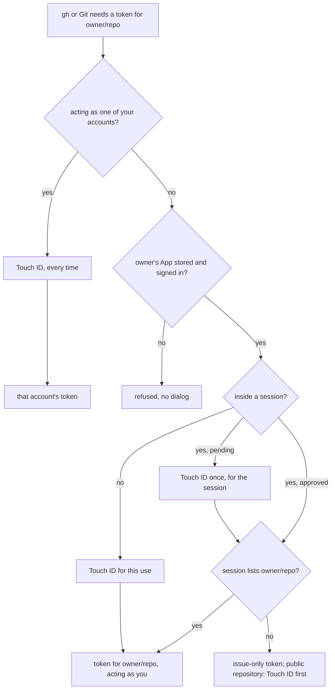

# gh-touchid

gh-touchid puts Touch ID in front of `gh` and Git access to GitHub on your Mac. `gh` and Git act as you, through a
private GitHub App you create for each owner. Every use gets its own token for one repository, and the token `gh`
used is revoked when `gh` exits. Outside a session, each use asks for Touch ID in a window that names who asked, the
command and the repository. An AI agent can run as a *session*, which you approve once instead of on every command.

Terms used below:

- **Owner**: the GitHub account or organization a repository belongs to, such as `acme` in `acme/widget`.
- **Sign-in**: your authorization of an owner's App. gh-touchid narrows each use's token from it.
- **Session**: a running program, such as an agent's harness, that you approved once with Touch ID. It and
  everything it starts get tokens for its repositories without Touch ID until it exits. See [Sessions](#sessions).
- **Elevate**: let tokens for a repository include the `workflows` permission for a while. See
  [Elevating a repository](#elevating-a-repository).
- **Your accounts**: GitHub accounts whose own tokens you stored, for what your Apps cannot reach. See
  [Acting as one of your accounts](#acting-as-one-of-your-accounts).

## Quick start

```sh
brew install georgelubaretsi/tap/gh-touchid
export PATH="/opt/homebrew/opt/gh-touchid/libexec/bin:$PATH"   # run `gh` through gh-touchid; put it in your profile

gh-touchid app create acme    # in the browser: create acme's App, authorize it, install it; answer Y to set up Git

cd ~/code/widget              # a clone of https://github.com/acme/widget.git
gh pr list                    # Touch ID, then a token for acme/widget only
git push                      # the same, for Git

gh-touchid session            # make this shell a session; start your agent from it
```

After `gh-touchid session`, the first GitHub use from that shell or anything it starts asks for Touch ID once. After
that, `gh` and Git work without Touch ID for the repositories in the current folder, until the shell exits.

## Install

gh-touchid runs on macOS 26 (Tahoe) or later, on Apple silicon and Intel Macs. It uses the `git` on your PATH. Every
way to install it gives you the same release:

| File                    | What it is                                                                         |
| ----------------------- | ---------------------------------------------------------------------------------- |
| `bin/gh-touchid`        | gh-touchid itself, the only file that goes on your PATH                            |
| `libexec/bin/gh`        | a wrapper that runs `gh` through gh-touchid                                        |
| `libexec/gh-touchid/gh` | GitHub's own `gh` for macOS, the only `gh` gh-touchid runs ([details](#which-gh-runs)) |

### Homebrew

```sh
brew install georgelubaretsi/tap/gh-touchid
```

It installs beside Homebrew's `gh` formula. Homebrew's `opt` link keeps the wrapper's folder the same across updates:
`/opt/homebrew/opt/gh-touchid/libexec/bin` (`/usr/local/opt/…` on Intel).

### Release tarball

Download `gh-touchid-VERSION-macos.tar.gz` and its `.sha256` from the
[releases](https://github.com/GeorgeLubaretsi/gh-touchid/releases). Check it and unpack it into a folder that stays
put across updates:

```sh
shasum -a 256 -c gh-touchid-VERSION-macos.tar.gz.sha256
xattr -d com.apple.quarantine gh-touchid-VERSION-macos.tar.gz   # only for a download from a browser
mkdir -p ~/.local/gh-touchid
tar -xzf gh-touchid-VERSION-macos.tar.gz -C ~/.local/gh-touchid --strip-components 1
export PATH="$HOME/.local/gh-touchid/bin:$PATH"                 # in your shell's profile
export PATH="$HOME/.local/gh-touchid/libexec/bin:$PATH"         # also, to run `gh` through gh-touchid
```

A browser marks downloads as quarantined, and `tar` passes the mark on to the files it unpacks. Releases are
notarized, so macOS checks a quarantined gh-touchid with Apple, online, the first time it runs. Removing the attribute
before unpacking skips that check; so does `xattr -dr com.apple.quarantine ~/.local/gh-touchid` afterwards. `curl`
marks nothing. To update, unpack the new tarball over the old folder the same way.

### Nix

The flake has two packages that install the release tarball. Both need no Xcode and build with Nix's sandbox on.

| Package                       | Contents                                                                        |
| ----------------------------- | ------------------------------------------------------------------------------- |
| `packages.<system>.default`   | `bin/gh-touchid` and the wrapper in `libexec/bin`; no `bin/gh`                  |
| `packages.<system>.with-gh`   | the same, plus `bin/gh`: a link to the wrapper, to replace `gh` where installed |

In a Darwin development shell:

```nix
{
  inputs.gh-touchid.url = "github:GeorgeLubaretsi/gh-touchid";

  outputs = { nixpkgs, gh-touchid, ... }:
    let
      system = "aarch64-darwin";
      pkgs = import nixpkgs { inherit system; };
    in {
      devShells.${system}.default = pkgs.mkShell {
        packages = [
          gh-touchid.packages.${system}.default   # gh-touchid only; .with-gh for `gh` through it too
          pkgs.git
        ];
      };
    };
}
```

with an `.envrc` of `use flake`. Or in your profile:

```sh
nix profile install github:GeorgeLubaretsi/gh-touchid           # gh-touchid only; `gh` stays as it is
nix profile install github:GeorgeLubaretsi/gh-touchid#with-gh   # also `gh`, through gh-touchid
```

`with-gh` cannot share a profile with another package that has `bin/gh`, such as nixpkgs' `gh`. The release Nix
installs is pinned in `release/nix.json`, which each release updates. Without that file, `default` builds from source
like `packages.<system>.from-source` (see [Building from source](#building-from-source)), which installs the same
files.

### Running `gh` through gh-touchid

Only `gh-touchid` goes on your PATH, so it installs beside any other `gh`. Git goes through gh-touchid once you
[set it up](#3-git). `gh` goes through it only if you choose one of these:

| Choice                                      | Who gets gh-touchid's `gh`                                  |
| ------------------------------------------- | ----------------------------------------------------------- |
| Put the wrapper's folder first in PATH      | every program that runs `gh` with that PATH, agents included |
| `alias gh='gh-touchid gh'`                  | your own interactive shell only                             |
| Run `gh-touchid gh …`                       | that command only                                           |

`gh-touchid status` prints the PATH line for your installation.

Uninstalling another `gh` does not make `gh` gh-touchid's: without one of the choices above, `gh` is not found.
gh-touchid never uses another `gh`'s login or configuration. But another `gh` that is signed in (`gh auth login`)
stays usable by any program running as you, whichever `gh` comes first on PATH. Run `gh auth logout` with it, or
uninstall it. `gh-touchid status` says which `gh` comes first on PATH and whether another one is signed in.

### Signed releases

Releases, which Homebrew and the flake's default package install, are signed with a Developer ID, run with the
hardened runtime, and are notarized by Apple. (GitHub's `gh` inside stays as GitHub signed it.) What that gives you:

- The login Keychain trusts gh-touchid by its signature (the identifier `com.lubaretsi.gh-touchid` and the Developer
  ID team), so **Always Allow** lasts across updates. Items allowed for an unsigned release ask for your login
  Keychain password once more, the first time a signed release reads them. Allow it only when the dialog names
  `gh-touchid`.
- The hardened runtime keeps other programs running as you from loading code into gh-touchid, such as a library
  through `DYLD_INSERT_LIBRARIES`. gh-touchid still does not defend against code that already runs as you (see
  [Security model](#security-model)).
- macOS runs a quarantined copy, such as a browser download, after checking it with Apple (see above).

Development builds and the flake's build from source (`from-source`) are only ad hoc signed, by the linker, and run
without the hardened runtime. The Keychain remembers **Always Allow** for one exact executable, so each new build asks
for your login Keychain password again, and another program running as you could load code into one.

## Setup

### 1. A GitHub App per owner

Create one App for each owner whose repositories you work on:

```sh
gh-touchid app create acme [--name NAME] [--no-open]
```

gh-touchid opens a local page, `http://127.0.0.1:47911/`, which sends GitHub a manifest for a private App. The App is
named `acme-touchid` unless `--name` says otherwise. It has no webhook, the callback URL
`http://127.0.0.1:47911/callback`, and these repository permissions:

| Permission                                          | Access         |
| --------------------------------------------------- | -------------- |
| Contents, Pull requests, Issues, Actions, Workflows | Read and write |
| Checks, Commit statuses, Metadata                   | Read-only      |

The browser then goes through three pages on GitHub:

1. **Create GitHub App.** GitHub creates the App for the account you are signed in as in that browser, or for the
   organization when the owner is one. gh-touchid checks that the App belongs to the owner. It keeps the App's client
   ID and client secret, and drops the private key and webhook secret, so it never acts as the App.
2. **Authorize.** You sign in to the new App as yourself (GitHub's web flow, with PKCE). Your sign-in is an access
   token that lasts 8 hours and a refresh token that renews it for 6 months. One Touch ID then stores the App and your
   sign-in in your login Keychain.
3. **Install.** Install the App on the owner, for all repositories or only the ones agents should reach.

At the end, in a terminal, gh-touchid asks `Set up Git for acme now? [Y/n]` and runs [`git setup`](#3-git) for you.
Without a terminal it prints the command instead.

If something goes differently:

- GitHub made the App for another account: nothing is stored, and gh-touchid says where to delete the App.
- You did not authorize: gh-touchid asks for Touch ID to keep the App alone. Finish with
  [`app login`](#signing-in-again).
- `--no-open` prints the first URL instead of opening it, for use in another browser profile.
- gh-touchid waits up to an hour for **Create** and 15 minutes for **Authorize**. Nothing else may listen on port
  47911 meanwhile: GitHub sends the browser back to exactly that address.

### 2. Or: an App made by hand

Create the App yourself in **Settings → Developer settings → GitHub Apps** with:

- the permissions above, and **Administration** at **No access**;
- **Only on this account**;
- the callback URL `http://127.0.0.1:47911/callback`.

Generate a client secret on its settings page, then run:

```sh
gh-touchid app set acme --client-id Iv23li...
```

It reads the client secret at a hidden prompt, or from stdin. Then it sends the browser to the App's **Authorize**
page. The code exchange checks the secret. After it, one Touch ID stores the App and your sign-in, and gh-touchid
offers to set up Git, as `app create` does.

### Signing in again

gh-touchid renews your sign-in as you use it. It ends after six months without use, or when you revoke it on GitHub
(**Settings → Applications → Authorized GitHub Apps**). `gh` and Git then fail with "you are not signed in". (If the
use asks for Touch ID, you see this after it: only then does gh-touchid read the sign-in.) Sign in again with:

```sh
gh-touchid app login acme [--no-open]
```

### 3. Git

Let gh-touchid answer Git's HTTPS credential requests for an owner's repositories (`app create` and `app set` offer
to do this):

```sh
gh-touchid git setup acme
```

It writes these entries with `git config --global`, and prints them:

```ini
[credential "https://github.com/acme"]
	helper =
	helper = !/opt/homebrew/bin/gh-touchid git credential
	useHttpPath = true
```

- The empty first helper turns off any other helper, such as `osxkeychain`, for these repositories.
- `useHttpPath` tells gh-touchid which repository Git is talking to.
- Write the owner as it appears in your remotes' URLs: Git compares it case-sensitively.
- Use HTTPS remotes: `https://github.com/acme/REPO.git`.

The helper's path is one that survives updates: the first `gh-touchid` on PATH that is this one. A link such as
`/opt/homebrew/bin/gh-touchid`, `/etc/profiles/per-user/$USER/bin/gh-touchid` or `~/.nix-profile/bin/gh-touchid` wins
over a path in Homebrew's Cellar or the Nix store. If only such a versioned path exists, gh-touchid uses it and tells
you to run `git setup` again after each update.

Running `git setup` again replaces its own entries and moves them to the end of the file. There they come after any
broader `credential.helper`, such as the one `gh auth setup-git` writes for all of github.com, and turn it off for the
owner. `gh-touchid status` says for each owner which helpers Git asks.

To push as one of your accounts to other owners' repositories, configure the same three settings for
`https://github.com` as a whole. Git reads public repositories without asking. For other owners' private ones,
gh-touchid refuses unless you [act as an account](#acting-as-one-of-your-accounts).

### 4. Your accounts (optional)

For what your Apps cannot reach, such as other people's repositories, store a token of each GitHub account you want
to act as. `account add` reads the token at a hidden prompt, or from stdin:

```sh
gh-touchid account add octocat
gh-touchid account remove octocat
```

`account add` asks GitHub whose token it is (`GET /user`). It stores nothing unless the token is that login's. It
prints the token's scopes, asks for Touch ID and stores the token in your login Keychain. `account remove` deletes the
token without Touch ID.

To contribute to public repositories the account is not a member of, such as opening a pull request on someone else's
project, use a classic token with the `repo` scope (and `workflow` to change workflows). A fine-grained token
(`github_pat_…`) cannot do that; `account add` warns about it.

## Everyday use

With `gh` going through gh-touchid (see [Install](#running-gh-through-gh-touchid)) and Git set up for the owner, use
`gh` and Git as usual:

```sh
gh pr list
gh pr create --fill
git push
```

Outside a session, each command asks for Touch ID. It then gets a token for one repository that acts as you, and
prints `To approve this whole session once, run: gh-touchid session` to stderr.

On GitHub, the work appears as your account, marked "via" the App. Tools that look for a person treat it as yours:
Codex reviews the pull requests and answers `@codex review`, and `@me` searches and review requests work.

### Which repository a command gets a token for

| Command                    | Repository                                                                         |
| -------------------------- | ---------------------------------------------------------------------------------- |
| `gh … -R/--repo X`         | `X`: `OWNER/REPO`, `github.com/OWNER/REPO` or a URL                                |
| `gh api repos/OWNER/REPO/…` | the one the endpoint names (not with `{owner}`/`{repo}` placeholders)             |
| any other `gh` command     | `GH_REPO` if set, else the current repository's `origin`                           |
| Git                        | the repository in the URL                                                          |

A flag right before `-R` might take it as its value, as in `gh issue create --body -R`. For such commands only,
gh-touchid reads which flags take values from the pinned `gh`'s `help reference`. If that cannot settle it,
`gh-touchid as LOGIN gh …` is refused, since an account's token is not limited to the repository in the dialog.

If the owner has no App stored, `gh` and Git are refused before any Touch ID dialog, with a hint naming your stored
accounts. If you are not signed in to the owner's App, the hint names the `app login` command to run.

How a use gets its token:



### The Touch ID window

Each Touch ID request opens a small floating window. It takes the keyboard (for Esc) but leaves the app you are in
active. It shows `gh-touchid`, "approval needed", then one fact per row:

- the action: `push`, `open pull request`, `store app and sign in`;
- the repository, and the branch, title or command where they apply;
- the program that asked and its folder (`agent · ~/code/widget`); the full process chain goes to the
  [access log](#status-lock-and-the-access-log);
- who it acts as: you via the App, or one of your accounts;
- the scope: `once`, `until agent quits`, or a duration.

The scope and any risk are in orange. Nothing is shortened: every repository, the whole title, the body (also one
given with `--body-file`) and the command are shown. A value too tall for the window scrolls in a box that says how
many lines it has.

- To allow, touch the sensor. Its control sits beside what you allow, such as "allow once".
- To deny, press Esc or click **deny**.
- After five minutes without an answer, the window closes and the command fails.
- While the screen is locked, nobody can answer. The command fails at once with "the screen is locked, so nobody could
  approve this". The same happens if the screen locks while a dialog is up.
- Where no window can be shown, such as over SSH, macOS's own Touch ID sheet asks instead, in one line:
  "gh-touchid is trying to let agent run “git push” on owner/repo."

### Acting as one of your accounts

To use one of [your accounts' tokens](#4-your-accounts-optional) instead of your sign-in to the App:

```sh
gh-touchid as octocat gh pr merge 12    # gh with octocat's token
gh-touchid as octocat git push          # runs git with GH_TOUCHID_AS=octocat, which gh and Git honour
gh-touchid as octocat -- git push       # the same; the `--` is optional
```

- Every use asks for Touch ID, inside sessions too. The window says "as octocat (your account)", the command and the
  repository, when there is one (`gh api user` has none).
- Git gets the login as the username.
- `GH_TOUCHID_AS=octocat` in the environment does the same for any `gh` or Git command.
- For pull requests to other people's repositories, the account needs a classic token with `repo`
  ([why](#4-your-accounts-optional)), and Git needs the [settings for all of github.com](#3-git).

## Sessions

```sh
gh-touchid session
gh-touchid session --repo acme/one --repo acme/two
```

`session` registers the program that ran it, such as the shell in your terminal or an agent's harness, for these
repositories:

- With `--repo`: the ones named.
- Without: the outermost Git repository containing the current folder, and the Git repositories nested up to two
  levels below it (an umbrella folder with clones inside). It keeps those with a github.com `origin` whose owner has
  an App stored.

gh-touchid looks past shells that only run a command or a script (`sh -c …`, `bash script.sh`) to the program that
started them. So a harness that runs `sh -c 'gh-touchid session'` registers itself. An interactive shell registers
itself.

The session is *pending* until its first GitHub use. Then one Touch ID window asks to let the program use those
repositories until it quits, and open issues in your other repositories. It names the program's folder and when it
started. From then on, the program and everything it starts get tokens for those repositories without Touch ID,
until it exits.

- **Other repositories** that one of your Apps is installed on get issue-only tokens: open and comment on issues, read
  the code, never `workflows`, even when elevated. A private one needs no dialog. A public one asks for Touch ID on
  each use (the window marks it public), and the token is revoked if you decline. Git gets the issue-only token for a
  private repository, so fetching works and pushing does not. It gets nothing for a public one, which it reads
  without a credential.
- **Processes outside the session** still ask for Touch ID on each use. Acting as an account always does.
- **Several commands at once**: when commands of a pending session start together, one dialog covers them all.
- **Nesting**: for each repository, an approved session that lists it decides, even when a pending session that does
  not list it was registered further down.
- **Running `session` again** from the same program with the same repositories keeps its approval. Other repositories
  make it pending again.
- gh-touchid knows nothing about agent tools. An agent harness, or a plugin of it, runs `gh-touchid session` at the
  start of its session. In a terminal, running it makes that shell a session.

## Elevating a repository

Tokens never include the `workflows` permission, which changing `.github/workflows` needs, unless the repository is
elevated:

```sh
gh-touchid elevate --for 30m --repo acme/one
```

- `elevate` asks for Touch ID.
- `--for` takes `30m`, `8h`, `1h30m` or `1d`, the longest.
- Each `--repo` names one repository. Without one, the current repository is elevated.
- Running `elevate` again sets a new end time.
- Elevation counts when a token is made, which is after any Touch ID dialog. A command still waiting on a dialog when
  the elevation ends, or when `lock` runs, gets a token without `workflows`.

## Status, lock and the access log

```sh
gh-touchid status
gh-touchid lock      # ends every session approval and elevation now
```

`status` shows:

- stored Apps, with who is signed in to each (or the `app login` to run), and your accounts (names only);
- for each owner, which credential helpers Git asks, with `fix: gh-touchid git setup OWNER` unless it is this
  gh-touchid alone;
- which `gh` comes first on PATH: gh-touchid's wrapper, another `gh`, or none. Unless it is the wrapper, it prints the
  PATH line for this installation and the alias. For Homebrew that is the `opt` folder, which stays the same across
  updates;
- whether another `gh` is signed in, when a `gh` other than the wrapper is on PATH: `another gh is signed in as
  LOGIN: any program can use that login; gh auth logout to close it`. It runs no other `gh` to tell. It looks only
  for an `oauth_token` in gh's `hosts.yml` (in `GH_CONFIG_DIR`, `$XDG_CONFIG_HOME/gh` or `~/.config/gh`) and for
  gh's Keychain item `gh:github.com`, by its attributes, never its secret;
- sessions (pending or approved, program, folder, start time, repositories) and elevations.

Sessions and elevations live in a small background agent that `session` or `elevate` starts. It exits when nothing is
left. Logging out or restarting ends everything too. (See [Security model](#sessions-and-the-background-agent).)

Every use, granted or refused, is logged to `~/Library/Logs/gh-touchid/access.log` with the chain of processes that
asked:

```text
granted acme/one (session agent[700]), elevated as octocat to gh-touchid[812] < git-remote-https[811] < git[810] < zsh[790] < agent[700]
granted acme/three (issues, session agent[700]) as octocat to …
granted acme/one (as octocat) to …
```

The log also records sign-ins, renewals, sessions registered, approved and ended, and elevations.

## Organizations with more members

For an organization, one App serves every member. Only one person runs `app create`; a second `app create` for the
same organization makes a second, duplicate App.

1. An organization owner (or App manager) runs `gh-touchid app create acme` and installs the App on the repositories
   members should reach.
2. For each member, the organization owner generates a client secret on the App's settings page. They hand it, with
   the App's client ID, to that member privately.
3. The member runs `gh-touchid app set acme --client-id Iv23li...`, enters the secret at the hidden prompt, and
   authorizes the App as themselves.

A member's tokens reach only repositories where the App is installed **and** the member has access. Removing the
member from the organization ends that. Also delete their client secret on the App's settings page.

Only organization owners and App managers can generate a private key for the App, which acts as the App's bot
([details](#tokens-and-what-they-reach)). A member cannot.

## Command reference

`gh-touchid help` lists every command; `gh-touchid help <command>` or `gh-touchid <command> --help` shows one.

| Command | What it does |
| --- | --- |
| `app create <owner> [--name <name>] [--no-open]` | make the owner's private App in the browser and sign in to it |
| `app set <owner> --client-id <id> [--no-open]` | use an App made by hand; reads its client secret, then signs in |
| `app login <owner> [--no-open]` | sign in to the owner's App again |
| `account add <login>` | store a token of one of your GitHub accounts, once GitHub confirms the login |
| `account remove <login>` | delete that token |
| `gh <arguments...>` | run GitHub CLI with a token for one repository |
| `git setup <owner>` | make this gh-touchid Git's only credential helper for the owner's repositories |
| `git credential <get\|store\|erase>` | that helper; answers only Git's HTTPS transport |
| `as <login> [--] <command> [arguments...]` | run a command as one of your accounts, with Touch ID on every use |
| `session [--repo <owner/name>]...` | register the program that ran it as a [session](#sessions) |
| `elevate --for <duration> [--repo <owner/name>]...` | add `workflows` to the repositories' tokens for a while |
| `status` | show Apps, accounts, Git and `gh` setup, sessions and elevations |
| `lock` | end every session approval and elevation now |
| `version` | print the version |
| `help [<command>]` | print every command's usage, or one command's |

Everything after `gh-touchid gh` goes to GitHub CLI, so `gh-touchid gh --help` is GitHub CLI's help.

## AI agent usage

This workflow has been tested only with [Oh My Pi (OMP)](https://github.com/can1357/oh-my-pi) on macOS. Other agent
harnesses have not been verified to keep hidden PTY input and Git credential-helper traffic outside model context.

- Agents run ordinary `gh` and Git commands. Inside an approved session they need no Touch ID for the session's
  repositories and act as you through the App. Anything else asks for Touch ID on each use. For `gh`, the wrapper's
  folder must come first in the PATH the agent gets; an alias in your shell does not reach it.
- Starting a session is the user's decision. The user, or a harness plugin, runs `gh-touchid session` from the agent's
  process (a tool's `sh -c` counts as the agent). The first GitHub use then shows the approval dialog, and the user
  decides. Outside a session, gh-touchid prints a hint to stderr with each per-use dialog.
- `elevate` and `as` are the user's decision too. Show the exact command, its repositories and duration before
  starting it.
- Storing Apps, sign-ins and account tokens is for humans only. Run `gh-touchid account add` and `app set` in an
  interactive PTY where the user types at the hidden prompt. Run `app create` and `app login` from the user's own
  terminal. Never request or accept a token, secret or key through chat, tool arguments, environment dumps or agent
  messages.
- Use an OMP supervised PTY for commands waiting on Touch ID, so that normal conversation does not abort the process.
- On first use, macOS may ask for the login Keychain password: a signed release once more after the first signed
  update, a development build after each new build. Choose **Always Allow** only when the dialog names `gh-touchid`
  and a `com.lubaretsi.gh-touchid` item. Deny it if it names Terminal, `security`, `gh` or another process. Never ask
  for, enter, or handle the user's Mac password.
- If Touch ID is declined or not answered (dialogs close after five minutes), stop and report it. Do not inspect the
  Keychain, switch credentials, or fall back to other GitHub authentication.
- Never invoke credential-revealing paths such as `gh auth token`, `git credential fill`,
  `gh-touchid git credential get` or `security find-generic-password -w`. Never talk to the agent's socket directly.
- Never enable shell or HTTP tracing around authenticated commands, including `set -x`, `GIT_TRACE`,
  `GIT_TRACE_CURL`, `GIT_CURL_VERBOSE` or `GH_DEBUG`.
- Treat command stdout and stderr as model-visible. Tokens are meant only for the pinned `gh` child and Git's
  credential pipe. They must never be printed or inspected.

## Security model

gh-touchid makes token use visible, approved and short-lived, and the access log shows who asked. It does not defend
against code that already runs as you ([below](#what-gh-touchid-does-not-defend-against)). The full threat model is in
[docs/threat-model.md](docs/threat-model.md); to report a vulnerability, see [SECURITY.md](SECURITY.md).

### Tokens and what they reach

- Every token gh-touchid makes acts as you. It is narrowed from your sign-in to the owner's App
  (`POST /applications/{client_id}/token/scoped`) to one repository, without `workflows` unless the repository is
  elevated. Issue-only tokens never include `workflows`.
- A narrowed token lasts as long as the sign-in's access token: at most 8 hours, at least one. gh-touchid renews the
  sign-in when less than an hour is left.
- The token of a `gh` command is revoked when `gh` exits. SIGINT, SIGQUIT, SIGHUP and SIGTERM sent to gh-touchid are
  passed on to `gh`, and the token is still revoked. SIGKILL leaves it to run out.
- Tokens given to Git are not revoked. They run out on their own.
- Narrowed tokens are never cached, never written to disk, and never exported to the calling shell.
- `gh` gets its token through `GH_TOKEN`, with a fresh empty `GH_CONFIG_DIR`. Programs `gh` starts while it runs
  inherit that environment, token included: your editor or browser, Git and the repository's hooks, and installed
  `gh` extensions.
- Git gets its token through its credential-helper pipe. gh-touchid answers only when the request comes from Git's
  HTTPS transport (`git-remote-https`) and stdout is not a terminal.
- `gh` commands that would print or store the token, or install aliases or extensions, are refused: `auth` (except
  `auth status` without `-t`), `--show-token` anywhere, `alias`, and `extension` (also as `extensions` or `ext`).
- Your sign-in (the access token, and the refresh token that renews it for six months) and the App's client secret
  stay in the Keychain. Together they reach every repository the App is installed on, with all its permissions, as
  far as your own access goes. gh-touchid uses them only to narrow, renew and revoke tokens. It keeps only sign-ins
  that expire.
- A refresh token works once, so renewing happens under a lock that other gh-touchid processes wait for.
- gh-touchid holds no private key of the App, so nothing it keeps can act as the App's bot. But whoever owns the App
  on GitHub (you, or your organization's owners and App managers) can generate a new key in its settings. With it
  they can act as the bot on every account the App is installed on, as with any GitHub App.
- Your accounts' tokens are as long-lived and broad as you made them on GitHub, and gh-touchid never revokes them.
  Every use asks for Touch ID and names the command, the repository and who asked. The token goes only to the `gh`
  that gh-touchid starts, or to Git's transport.
- A `gh` signed in on its own (`gh auth login`, with its token in the Keychain or in its `hosts.yml`) is a way to
  GitHub that gh-touchid does not gate. Any program running as you can use that login, whichever `gh` comes first on
  PATH. `status` says when one is; `gh auth logout` with that `gh` closes it.

### What is stored where

| What | Where |
| --- | --- |
| each owner's App: client ID and secret | login Keychain, service `com.lubaretsi.gh-touchid.app`, account = owner |
| your sign-in to each owner's App | login Keychain, service `com.lubaretsi.gh-touchid.signin`, account = owner |
| your accounts' tokens | login Keychain, service `com.lubaretsi.gh-touchid.user`, account = login |
| sessions and elevations | memory of the background agent only |
| the access log | `~/Library/Logs/gh-touchid/access.log` |

- The Keychain items are generic passwords, available only while this Mac is unlocked, kept on this Mac only and
  never synced.
- A development build keeps its own items, under `com.lubaretsi.gh-touchid.dev.*`
  ([details](#development-builds)).
- `status`, the hints and the checks before a dialog read only which items exist, the App's name (its slug) and the
  signed-in login. Those two are kept in the items' comments. They never read a secret. `status` also asks whether
  gh's own item `gh:github.com` exists, by its attributes alone.
- Releases run with the hardened runtime, so another program cannot load code into gh-touchid to use the items;
  development builds and the build from source run without it. Either way gh-touchid itself enforces the protection:
  it asks for Touch ID or checks the session before it uses the items. But macOS lets a process read them once you
  allow it in the Keychain dialog or with your account password.

### Which `gh` runs

gh-touchid runs only the `gh` it was built with. No environment variable changes which one.

- **Releases** (the tarball, Homebrew, and the flake's default package) bundle GitHub's `gh` in
  `libexec/gh-touchid`. Any program running as you can write there, as in all of Homebrew's folders. So:
  1. Before it makes a token, gh-touchid checks the file's SHA-256. A changed `gh` is refused: "the gh next to
     gh-touchid was changed; reinstall gh-touchid".
  2. It starts `gh` suspended, before its first instruction. It lets `gh` run only if the code the kernel loaded for
     it (the slice that runs, natively or under Rosetta) has the code directory hash (cdhash) of GitHub's `gh`
     pinned at build time. Otherwise, or if that cannot be read, `gh` is killed unrun. So replacing the installed
     `gh` after the SHA-256 check cannot hand the token to another program.
  3. GitHub's `gh` runs with the hardened runtime, so a page changed after it starts gets it killed.
- **The Nix build from source** (`packages.<system>.from-source`) runs nixpkgs' `gh` by its store path and checks its
  SHA-256, without a cdhash. nixpkgs' `gh` is a wrapper script, and the read-only Nix store keeps it from being
  replaced.
- **Development builds** run `GH_TOUCHID_GH` or the `gh` on PATH; only they honour `GH_TOUCHID_GH`.

### Sessions and the background agent

- Everything inside an approved session shares its access. Any process the session's program starts, at any depth,
  gets tokens for the session's repositories without Touch ID until the program exits. It can also open issues on,
  and read, every private repository your Apps are installed on. Approve sessions only for programs you trust, with
  the repositories they need.
- The background agent holds no tokens or keys. It answers only processes running as you, on a socket in your
  private temporary directory (`getconf DARWIN_USER_TEMP_DIR`).
- The agent trusts only the gh-touchid executable it was started from: only that executable may approve a session or
  elevate a repository. gh-touchid ignores an agent socket served by any other program. Each gh-touchid executable
  path has its own agent.
- Any process running as you can register its parent (or the program above its non-interactive shells) as a pending
  session, which still needs your Touch ID. It can also see the status, or `lock`.

### Signing in

- `app create`, `app set` and `app login` listen on `127.0.0.1:47911` until GitHub sends the browser back: at most an
  hour for **Create**, 15 minutes for **Authorize**.
- They accept only answers that carry the random `state` they gave GitHub. The code exchange also needs the PKCE
  verifier, which only this process holds.
- The App's secret and your sign-in go from GitHub's replies straight to the Keychain.

### What gh-touchid does not defend against

Code that already runs as you and sets out to tamper with gh-touchid. For example, it can load code into a development
build or a build from source (ad hoc signed, without the hardened runtime; a release's hardened runtime blocks that),
or answer the Keychain dialogs.

## Upgrading

### From 0.3.1 or earlier to 0.4

0.3.1 and earlier acted as each App's bot, with the App's private key. 0.4 acts as you, and refuses an App stored by
an older version: "the App stored for OWNER comes from gh-touchid 0.3 or earlier". For each owner:

1. Run `gh-touchid app create OWNER` and go through **Create**, **Authorize** and **Install**. The new App is named
   `OWNER-touchid`, so it does not clash with the old default, `OWNER-agent`. It replaces the stored App.
2. Run `gh-touchid git setup OWNER`. The helper command changed from `git-credential` to `git credential`, and the old
   entry no longer works. `status` shows `fix:` for each owner still on it.
3. Delete the old App on GitHub: its settings page, **Advanced → Delete GitHub App**.

Commands that changed:

| 0.3                     | 0.4                        |
| ----------------------- | -------------------------- |
| `user add <login>`      | `account add <login>`      |
| `user remove <login>`   | `account remove <login>`   |
| `git-setup <owner>`     | `git setup <owner>`        |
| `git-credential …`      | `git credential …`         |

Account tokens stored by 0.3 keep working.

### From 0.3.0

0.3.0 put its own `gh` in `bin/`. Later versions keep it in `libexec/bin`, off your PATH unless you add it. After
upgrading, `gh` is whatever other `gh` comes first on PATH, or not found: pick one of the
[ways to run it through gh-touchid](#running-gh-through-gh-touchid). Unpacking a newer tarball over 0.3.0 leaves
0.3.0's `bin/gh` behind; delete it. Then follow [the 0.3.1 steps](#from-031-or-earlier-to-04).

### From 0.2

- `unlock` is gone. Use [`session`](#sessions) for unattended work and [`elevate`](#elevating-a-repository) for
  workflow changes.
- `set` and the tokens stored per repository are gone. Store a token per GitHub account with `account add` and use it
  with `as`. The old items have Keychain service `com.lubaretsi.gh-touchid` and account `owner/repo`. List them with
  `security find-generic-password -s com.lubaretsi.gh-touchid -a owner/repo` (this prints no secret), and delete each
  with `security delete-generic-password -s com.lubaretsi.gh-touchid -a owner/repo`.
- Create an App per owner with `app create`, or make one by hand and use `app set`.
- Replace 0.2's per-repository `credential.helper` settings (`git config --local --unset-all credential.helper`) with
  `gh-touchid git setup OWNER`.

## Building from source

gh-touchid is built with the Swift compiler of Xcode 26 or later, as one universal executable for arm64 and x86_64.
Every task goes through the justfile, inside the dev shell (`nix develop`, or direnv), which has `just` and the
linters:

```sh
just build           # a development build in build/ (scripts/build.sh)
just test            # a test build (scripts/build.sh --testing) and the test suite in tests/, against a mock GitHub
just package         # the release tarball in dist/, as the release workflow builds it (scripts/package.sh)
just check-formula   # the Homebrew formula for dist/'s tarball, checked with a throwaway copy of the newest Homebrew
just lint            # the workflows with actionlint, the scripts with ShellCheck
```

`scripts/build.sh` takes `--xcode` to pick the Xcode (default `/Applications/Xcode.app`) and `--xcode-version` to
refuse any other version.

### Development builds

A development build runs `GH_TOUCHID_GH` or the `gh` on PATH, unchecked. It keeps its own Keychain items
(`com.lubaretsi.gh-touchid.dev.*`), so trying one never reads or replaces an installed gh-touchid's Apps, sign-ins
and tokens. It needs an App of its own, with a name of its own:

```sh
build/gh-touchid app create acme --name acme-dev
```

### Release builds

`scripts/package.sh` downloads GitHub's `gh` for macOS from the release pinned in `release/gh.json`, and refuses it
unless its SHA-256 matches. It builds gh-touchid to run only that `gh`, checked by its SHA-256 and by the cdhashes of
its two slices (`scripts/build.sh` with `--gh ../libexec/gh-touchid/gh`, `--gh-sha256` and `--gh-cdhash`).

On a `v*` tag, after the tarball passes its checks, the release workflow signs `bin/gh-touchid` with
`scripts/sign.sh`, in a job of the GitHub environment `release`, which holds the certificate and the notary key and
which only `v*` tags reach. It imports the Developer ID Application certificate into a temporary keychain, signs with
the hardened runtime, a secure timestamp and the identifier `com.lubaretsi.gh-touchid` (no entitlements), and has
Apple's notary service accept the result (`notarytool`). Then it repacks the tarball and its `.sha256` as
`scripts/package.sh` lays them out (`scripts/pack.sh`), checks that every other file, GitHub's `gh` above all, is
unchanged, and deletes the keychain and the keys. The signed tarball passes the tarball and formula checks again, and
only it is published: its SHA-256 goes into the formula and the Nix pin. Pull-request builds never see the secrets and
stay ad hoc signed. `scripts/sign.sh TARBALL --ad-hoc` signs with the ad hoc identity and the hardened runtime and
skips notarization, to check the repack and the hardened runtime without the certificate.

`just check-formula` (`nix run .#check-formula`) renders the formula for the tarball. Then it runs `brew style`,
`brew audit --strict`, `brew install`, `brew test` and `brew linkage`, and checks that Homebrew installed gh-touchid
and GitHub's `gh` byte for byte as the tarball has them, with a copy of Homebrew's newest release made for the check
in `~/Library/Caches/gh-touchid/check-formula` and deleted after it. So it needs no sudo and never touches the
Homebrew you use. The release workflow runs the same checks on every pull request and tag, before anything is
published. The tap runs `brew test-bot` on changes made there.

### Tests

`just test` builds a test build. It keeps its state in `GH_TOUCHID_TEST_DIR`, talks to a mock GitHub at
`GH_TOUCHID_API_URL`, prints `AUTH:` and `OPEN:` lines instead of showing Touch ID or a browser, and runs a fake
`gh`. Then `bun test` runs the suite in `tests/` against it. The check workflow runs `just test` and `just lint` on
every pull request and push to main. The release workflow runs `just test` before packaging.

### Nix from source

The flake's `packages.<system>.from-source` builds through the same script with Xcode 27.0, which Nix cannot provide.
It pins nixpkgs' `gh` by its store path and SHA-256. Install Xcode 27.0 at `/Applications/Xcode.app` and build with
Nix's sandbox off or relaxed (`sandbox = false` or `sandbox = relaxed` in `nix.conf`; the package sets
`__noChroot`). The build stops, naming the Xcode it needs, when it finds another version. For an Xcode installed
elsewhere, or another version at your own risk, override the package:

```nix
gh-touchid.packages.${system}.from-source.override {
  xcode = { version = "27.0"; path = "/Applications/Xcode-27.0.app"; };
}
```
