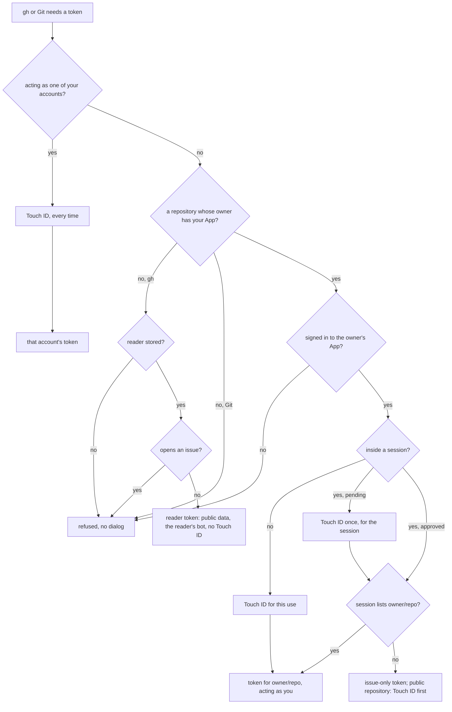

# Everyday use

With `gh` going through gh-touchid (see [Install](install.md#running-gh-through-gh-touchid)) and Git set up for the owner, use
`gh` and Git as usual:

```sh
gh pr list
gh pr create --fill
git push
```

Outside a session, each command asks for Touch ID. It then gets a token for one repository that acts as you, and
prints `gh-touchid: to approve this whole session once, run: gh-touchid session` to stderr.

On GitHub, the work appears as your account, marked "via" the App. Tools that look for a person treat it as yours:
Codex reviews the pull requests and answers `@codex review`, and `@me` searches and review requests work.

## Which repository a command gets a token for

| Command                    | Repository                                                                         |
| -------------------------- | ---------------------------------------------------------------------------------- |
| `gh … -R/--repo X`         | `X`: `OWNER/REPO`, `github.com/OWNER/REPO` or a URL                                |
| `gh api repos/OWNER/REPO/…` | the one the endpoint names (not with `{owner}`/`{repo}` placeholders)             |
| `gh repo archive\|clone\|delete\|edit\|fork\|sync\|unarchive\|view X` | `X`: `OWNER/REPO`, `github.com/OWNER/REPO` or a URL |
| any other `gh` command     | `GH_REPO` if set, else the current repository's `origin`                           |
| a `gh` command with none of these (`gh search …`, `gh api users/octocat`) | none: the [reader](setup.md#5-the-reader-optional) |
| Git                        | the repository in the URL                                                          |

A repository named only inside a GraphQL query (`gh api graphql`), in an endpoint outside `repos/OWNER/REPO`, or as a
`gh repo` argument without its owner is not read, so such a command gets a token for `GH_REPO` or the current folder's
repository. When gh then fails, gh-touchid says so, for example `gh-touchid: gh failed with a token for acme/widget
only, the current folder's repository: …; for another, set GH_REPO=OWNER/REPO`. To query another repository, run the
command in its folder or with `GH_REPO=OWNER/REPO`.

gh-touchid reads a `gh` command line the way `gh` does, from `gh`'s own list of its commands, aliases and flags
(`gh help reference`): which command runs, which flags take values, and so which `-R` names the repository, as in
`gh issue create --body -R`, where `-R` is the body. The dialog names the command `gh` runs (`gh pr checkout` for
`gh co 12`), whatever comes before it, as in `gh --limit 5 issue list`.

If the owner has no App stored, or the command names no repository, `gh` uses the [reader](setup.md#5-the-reader-optional)
when one is stored: no Touch ID, public data only. Without a reader it is refused before any Touch ID dialog, with a
hint naming `gh-touchid reader create` and your stored accounts. Git is refused for such owners before any dialog. If
you are not signed in to the owner's App, the hint names the `app login` command to run.

How a use gets its token:



## The Touch ID window

Each Touch ID request opens a small floating window. It takes the keyboard (for Esc) but leaves the app you are in
active. It shows `gh-touchid`, "approval needed", then one fact per row:

- the action: `push`, `open pull request`, `store app and sign in`;
- the repository, and the branch, title or command where they apply;
- the program that asked and its folder (`agent · ~/code/widget`); the full process chain goes to the
  [access log](status.md#status-lock-and-the-access-log);
- who it acts as: you via the App, or one of your accounts;
- the scope: `once`, `until agent quits`, or a duration.

The scope and any risk are in orange. Nothing is shortened: every repository, the whole title, the body (also one
given with `--body-file`) and the command are shown. A value too tall for the window scrolls in a box that says how
many lines it has.

- To allow, touch the sensor. Its control sits beside what you allow, such as "allow once". The window goes as soon
  as Touch ID answers, also when the command goes on afterwards, such as `reader create` waiting for the browser or a
  long gh command.
- To deny, press Esc or click **deny**.
- After five minutes without an answer, the window closes and the command fails.
- While the screen is locked, nobody can answer. The command fails at once with "the screen is locked, so nobody could
  approve this". The same happens if the screen locks while a dialog is up.
- Where no window can be shown, such as over SSH, macOS's own Touch ID sheet asks instead, in one line:
  "gh-touchid is trying to let agent run “git push” on owner/repo."

## Acting as one of your accounts

To use one of [your accounts' tokens](setup.md#4-your-accounts-optional) instead of your sign-in to the App:

```sh
gh-touchid as octocat gh pr merge 12    # gh with octocat's token
gh-touchid as octocat git push          # runs git with GH_TOUCHID_AS=octocat, which gh and Git honour
gh-touchid as octocat -- git push       # the same; the `--` is optional
```

- Every use asks for Touch ID, inside sessions too. The window says "as octocat (your account)", the command and the
  repository, when there is one (`gh api user` has none).
- Git gets the login as the username.
- `GH_TOUCHID_AS=octocat` in the environment does the same for any `gh` or Git command.
- For pull requests to other people's repositories, the account needs a classic token with `repo`
  ([why](setup.md#4-your-accounts-optional)), and Git needs the [settings for all of github.com](setup.md#3-git).
